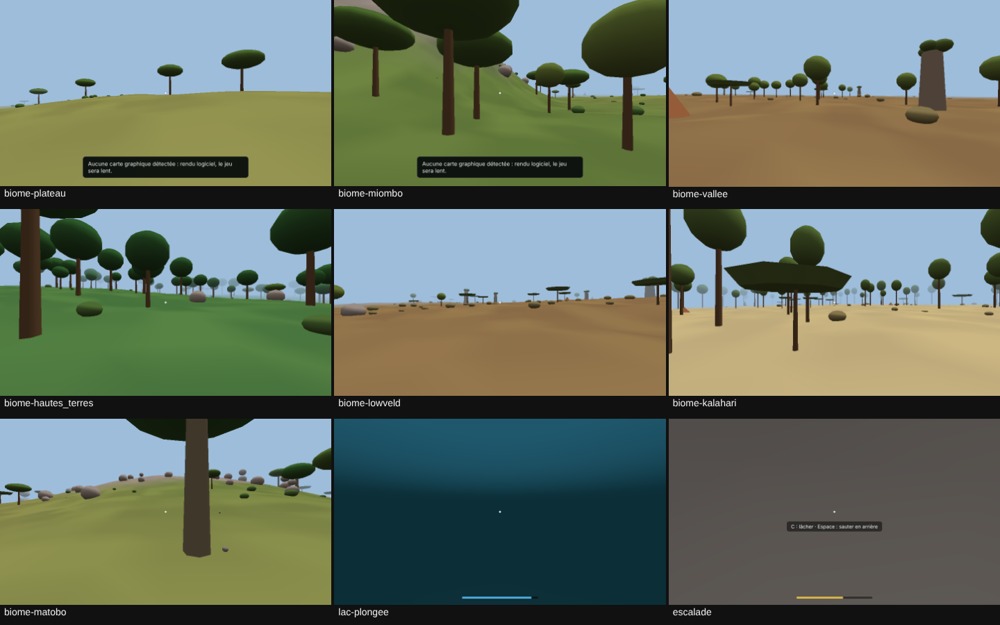

# Bienvenue au Zimbabwe

Jeu 3D de survie, d'exploration, de construction et d'horreur, jouable dans le navigateur et installable comme une application (PWA) sur téléphone, tablette et ordinateur.

**État : phase 2 terminée côté code et tests automatiques, à valider sur vos appareils.** Le prototype contient :
- un monde de 16 km × 16 km inspiré du Zimbabwe : vallée du Zambèze et grand lac, haut plateau, forêts de miombo, collines de granit, hautes terres, lowveld, sables du Kalahari ;
- les déplacements à la première personne : marche, course, accroupi, saut, nage et plongée, escalade, avec endurance, équilibre et chutes ;
- les objets à prendre, porter, lancer et traîner ;
- les commandes au clavier, à la souris, au tactile et à la manette ;
- des réglages graphiques adaptatifs et un test de performance intégré.

Le jeu est solo pour l'instant. Le multijoueur arrive en phase 8 : un joueur héberge le monde, les autres le rejoignent avec un code privé. Les graphismes restent volontairement simples. Le détail est dans [`docs/ETAT.md`](docs/ETAT.md).



## Jouer

Site : https://bienvenue-au-zimbabwe.vercel.app

Tant que la protection Vercel est activée, il faut être connecté à son compte Vercel pour ouvrir le site. Pour l'ouvrir à tout le monde, allez dans le projet Vercel, Settings, puis Deployment Protection.

| Action | Clavier / souris | Manette | Tactile |
| --- | --- | --- | --- |
| Se déplacer | W A S D (Z Q S D en AZERTY) ou flèches | Stick gauche, croix | Joystick (moitié gauche de l'écran) |
| Regarder | Souris (cliquez dans le jeu) | Stick droit | Glisser sur la moitié droite |
| Sauter · grimper face à une paroi · monter (nage) | Espace | A / Croix | Bouton « Sauter » |
| Courir · nager vite | Maj gauche (maintenir) | Clic du stick gauche | Bouton « Courir » |
| S'accroupir · plonger · lâcher la paroi | C | B / Rond | Bouton « Accroupir » |
| Prendre · poser · traîner un objet | E | X / Carré | Bouton « Prendre » |
| Lancer l'objet porté | Clic gauche | RT / R2 | Bouton « Lancer » |
| Menu / pause | Échap | Start | Bouton ☰ |
| Infos de performance | F3 | Select | — |

Toutes les touches se changent dans « Réglages » → « Commandes ».

Pour essayer rapidement chaque région, ouvrez le menu pause, puis « Réglages » → « Outils de test ». Vous y trouverez la téléportation vers le lac (nage), une paroi de granit (escalade) et chaque biome. Ces outils seront retirés ou réservés à l'hôte en multijoueur.

## Tester les performances sur vos appareils

Sur l'écran d'accueil, choisissez « Test de performance » puis attendez environ une minute. Touchez ensuite « Copier les résultats » et envoyez le texte. La procédure complète est dans [`docs/PHASE-1.md`](docs/PHASE-1.md).

## Développement

Il faut Node.js 20 ou plus.

```bash
npm install
npm run dev          # serveur de développement : http://localhost:5173
npm run build        # version de production dans dist/
npm run preview      # sert dist/ sur http://localhost:4173
npm run typecheck    # vérification des types
npm test             # tests unitaires (Vitest)
npm run test:e2e     # tests dans un vrai navigateur (Playwright + Chromium)
npm run check        # tout ce qui précède, dans l'ordre
```

Pour les tests navigateur sur votre machine, installez d'abord Playwright :

```bash
npm install --no-save playwright
npx playwright install chromium
```

Options des tests navigateur :
- `node tests/e2e/run.mjs --webgpu` ajoute le scénario WebGPU ;
- `--only=ordinateur,telephone,manette,phase2,performance,captures,webgpu` ne lance que certains scénarios.

Les captures et le rapport sont écrits dans `tests/e2e/out/`.

## Organisation du code

```
src/shared/     code commun au client et au futur serveur : géographie, relief, flore,
                objets, physique, déplacements, simulation à pas fixe, apparitions,
                protocole, codes de monde
src/client/     jeu dans le navigateur : rendu (Babylon.js), commandes, réglages,
                mesures de performance, écrans
src/server/     préparé pour la phase 8 : sauvegardes
src/vendor/     chargement du moteur physique en fichier WebAssembly séparé
public/         manifeste, service worker, icônes
tests/unit/     tests Vitest
tests/e2e/      tests Playwright
docs/           architecture, état des fonctionnalités, phase 1
```

## Publication

Le projet Vercel `bienvenue-au-zimbabwe` construit le site avec `npm run build` et publie le dossier `dist/` (voir `vercel.json`).

## Documentation

- [`docs/ARCHITECTURE.md`](docs/ARCHITECTURE.md) : architecture, technologies et raisons, compromis mobiles, risques
- [`docs/ETAT.md`](docs/ETAT.md) : fonctionnalités terminées, préparées et restantes
- [`docs/PHASE-1.md`](docs/PHASE-1.md) : architecture et prototype, procédure de test sur appareils réels
- [`docs/PHASE-2.md`](docs/PHASE-2.md) : monde et déplacements (carte, décisions, tests, limites)
