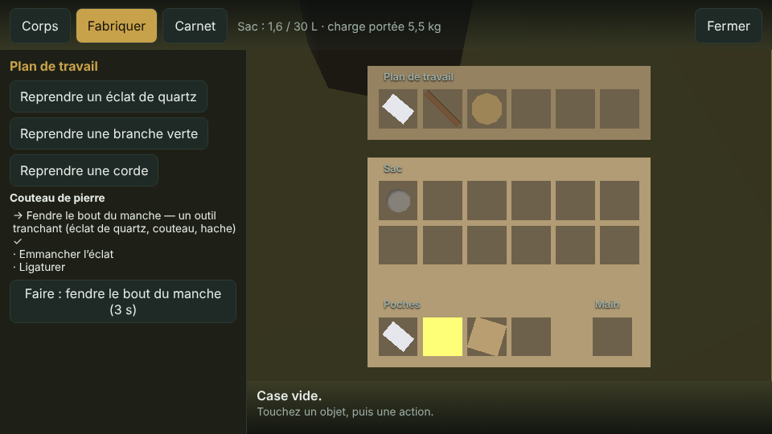
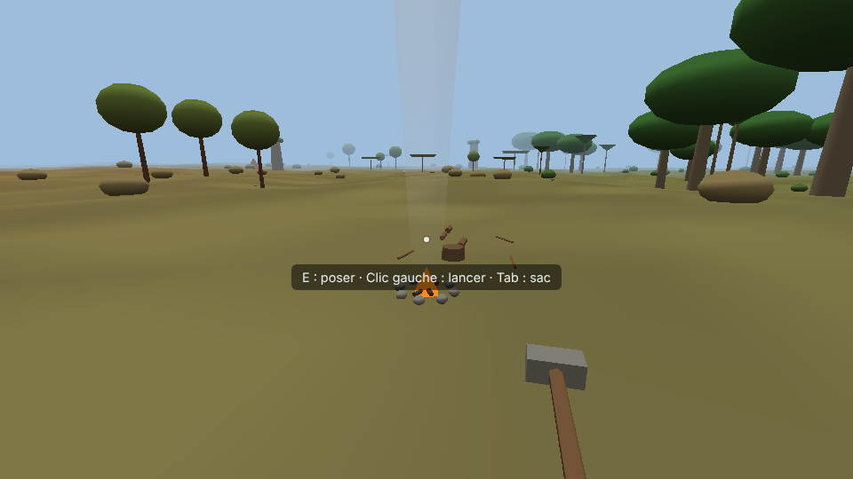
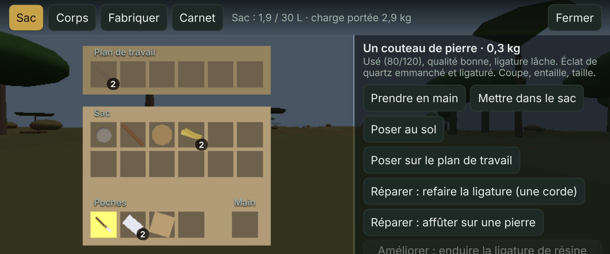
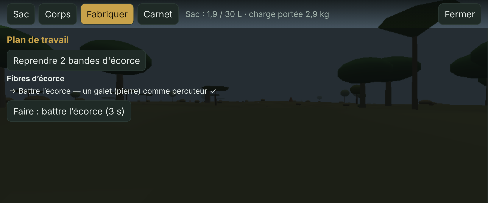

# Phase 4 — Ressources et fabrication

**Statut : terminée le 13/11/2026.** Vérifiée par 146 tests unitaires (dont 27 propres à la phase 4) et 31 vérifications de la phase 4 dans un vrai navigateur (ordinateur, téléphone, manette). Reste à l'essayer sur vos appareils.

## Ce que demande le cahier des charges

- Ressources communes, rares et très rares, réparties selon les régions et les biomes (9.1).
- Récolte par gestes physiques, en plusieurs étapes : extraction, découpe, récolte, démontage, outils (9.2).
- Fabrication physique complète : manipulation des pièces, outils, assemblage, fixations, étapes réalistes (9.3).
- Recettes connues, découvertes, expérimentation, apprentissage (9.4).
- Qualité, défauts, usure, réparations, améliorations (9.5).
- Renouvellement : régénération naturelle, épuisement, conséquences sur l'environnement (9.6) ; les actions des joueurs modifient durablement certaines zones (6.4).
- Recyclage : démontage physique, matériaux récupérés selon l'état et la composition (9.7).
- Armes de mêlée physiques : poids, équilibre, portée, durabilité, usure, fabrication libre (8.3). Les combats viennent en phase 6, mais les outils fabriqués ici en ont déjà les propriétés.

## Décisions (prises comme pour la phase 3, en m'inspirant de jeux du même style)

> **Section 15 du cahier.** La liste des matériaux et leurs propriétés, ainsi que le détail de l'amélioration de l'équipement, font partie des « éléments encore à spécifier ». Les choix ci-dessous (matériaux, recettes, valeurs, améliorations) sont donc des propositions, signalées et modifiables. Aucune n'est définitive.

### Matériaux du Zimbabwe (âge de la pierre d'abord)

| Matériau | Où | Rareté | Comment |
| --- | --- | --- | --- |
| Bois mort (bâtons), bûches | sous les arbres, forêts ; bûches des arbres abattus | commun | ramasser |
| Galets | partout | commun | ramasser ; un galet sert de percuteur |
| Quartz | blocs blancs sur les kopjes, l'escarpement et les berges ; filons épars sur tout le plateau | commun | frapper le bloc avec un galet : des éclats tranchants tombent |
| Écorce, puis fibres et corde | troncs d'arbres (le baobab est l'arbre à corde du pays) | commun | entailler avec un outil tranchant, battre, torsader |
| Branches vertes (manches), perches | arbres | commun | couper avec un outil tranchant (perche : à la hache, accroupi) |
| Herbes sèches | plateau, savanes, Kalahari | commun | arracher à la main (amadou pour le feu) |
| Feuilles d'ilala | palmiers ilala, près des fleuves | commun localement | couper, tresser |
| Argile | zones humides (vleis), berges | commun localement | creuser avec un bâton à fouir |
| Résine | mopanes, tecks, acacias | rare | entailler l'écorce, revenir dix minutes plus tard |
| Minerai de fer | quelques affleurements de l'escarpement, des hautes terres et des montagnes frontalières | rare | frapper avec un galet ; fonte avec les installations (phase 5) |
| Or | graviers de quelques rares berges de fleuve | très rare | orpailler avec une batée ; usage à définir (commerce, section 15) |

Inspiré de Vintage Story et de Primitive Technology (taille de la pierre, cordes d'écorce, manches ligaturés), ancré dans le pays : le quartz des kopjes de granit et des filons du plateau, la corde d'écorce de baobab, la vannerie en palmier ilala, la poterie, et l'histoire du fer et de l'or au Grand Zimbabwe.

### Récolte

| Décision | Inspirée de | Pourquoi |
| --- | --- | --- |
| On tient un outil en main et on « Utilise » sur la cible : chaque coup est un geste qui coûte de l'endurance et use l'outil ; maintenir enchaîne les coups | Valheim, The Forest, Green Hell | Gestes physiques (9.2), jouable au doigt et à la manette |
| Plusieurs étapes : frapper le quartz → éclats ; entailler l'écorce → bandes → battre → fibres → torsader → corde | Primitive Technology, Green Hell | Étapes réalistes |
| Les éclats, bandes et bûches tombent au sol comme de vrais objets, qu'on ramasse | Vintage Story, Sons of the Forest | Pièces manipulables |
| Abattre un arbre à la hache : il tombe, laisse une souche et donne des bûches ; il repousse au bout de 12 h de jeu | The Forest (souches qui repoussent), Sons of the Forest | Modification durable du monde (6.4) et régénération (9.6) |
| Les gisements s'épuisent puis se régénèrent, chacun à son rythme (herbes vite, quartz et fer très lentement) ; bâtons et fruits repoussent | Rust, Valheim | Écosystème dynamique (9.6). Abattre un arbre fait disparaître les fruits et le bois mort à son pied |

### Fabrication

| Décision | Inspirée de | Pourquoi |
| --- | --- | --- |
| Un **plan de travail** sur la toile du sac : on y pose les pièces, visibles en 3D | Sons of the Forest (toile), Green Hell (sac) | Manipulation des pièces (9.3), jouable sur téléphone |
| Chaque recette est une suite d'**étapes**, chacune avec son outil : par exemple, pour un couteau, fendre le manche avec un éclat, emmancher, puis ligaturer avec une corde | Primitive Technology, Kingdom Come (étapes) | Outils, assemblage, fixations (9.3) |
| Un **carnet** liste les recettes connues et pressenties | Green Hell (carnet) | Interface intégrée à l'univers (13.4) |
| Quelques recettes connues au départ ; d'autres pressenties en ramassant un nouveau matériau ou en fabriquant un objet | Valheim (recettes débloquées en ramassant), Grounded (analyser), Raft (recherche) | Recettes connues et découvertes (9.4) |
| **Expérimentation :** poser des pièces et essayer d'assembler ; si cela correspond à une recette, on la découvre. Un échec ne coûte rien et donne un indice | Green Hell, Minecraft | Expérimentation (9.4) |
| **Apprentissage :** chaque fabrication fait progresser la compétence « Fabrication » : meilleure qualité, moins de défauts, gestes plus rapides | Valheim (compétences), Green Hell | Apprentissage (9.4), progression par joueur (12.3) |

### Qualité, usure, réparation, recyclage

| Décision | Inspirée de | Pourquoi |
| --- | --- | --- |
| Chaque outil a une qualité (selon les pièces et la compétence) et parfois un défaut (ligature lâche, manche fendu) | — | Qualité et défauts (9.5) |
| L'usure suit l'état : neuf, usé, abîmé, très abîmé, cassé. Un outil usé travaille moins bien | DayZ (états des objets) | Usure (9.5) |
| Réparer (re-ligaturer avec une corde, affûter avec un galet) rend de la durabilité, mais chaque réparation réduit le maximum | DayZ, Valheim | Réparations (9.5) |
| Améliorer : durcir une pointe au feu, enduire une ligature de résine | Primitive Technology | Améliorations (9.5) ; détail signalé (section 15) |
| Démonter un objet rend ses pièces selon son état (un éclat usé casse, une corde abîmée se perd parfois) | — | Recyclage (9.7) |

### Feu

| Décision | Inspirée de | Pourquoi |
| --- | --- | --- |
| Monter un foyer (bâtons et herbes sèches), l'allumer avec un archet à feu : geste long et fatigant, qui échoue si l'on s'épuise avant la fin | Green Hell, Primitive Technology | Étapes réalistes |
| Le feu consomme du bois ; il sert à cuire l'argile (pot), faire bouillir de l'eau, stériliser des chiffons (pansements propres, sans risque d'infection) et durcir des pointes au feu | Green Hell, Vintage Story | Relie la fabrication aux soins de la phase 3 |
| Sa **fumée se voit de loin** | Big Walk (communication) | Le principe du jeu : un moyen de signaler sa position à ceux qui vous cherchent |

## Ce qui a été fait

### Gisements

Les gisements sont fixes et répartis par cases de 16 m selon le biome. Ils sont calculés à partir de la graine du monde, donc jamais transmis sur le réseau. On les frappe avec l'outil en main (« Utiliser »), sauf les herbes, qui s'arrachent à la main (E).

| Gisement | Où (part des cases de 16 m) | Outil | Coups | Donne | Réserve | Reconstitution |
| --- | --- | --- | --- | --- | --- | --- |
| Bloc de quartz | kopjes 7 %, Matobo et escarpement 3 %, berges basses 2 %, ailleurs 1,2 % | galet | 3 | 1 ou 2 éclats | 6 | 2 h |
| Touffe d'herbes sèches | plateau, lowveld, Kalahari, vallée, vleis, miombo : 14 % | la main | 1 | 1 brassée | 2 | 20 min |
| Gisement d'argile | vleis 8 %, berges basses 7 % | bâton à fouir | 4 | 1 boule | 5 | 1 h |
| Affleurement de fer | escarpement, hautes terres, montagnes frontalières : 1,2 % | galet | 10 | 1 morceau | 4 | 6 h |
| Gravier aurifère | berges basses des fleuves : 0,4 % | batée | 5 | 1 pépite, 3 fois sur 10 | 3 | 4 h |

**Distances mesurées depuis 24 points d'arrivée tirés au hasard :**

| Gisement | Distance médiane | Distance maximale |
| --- | --- | --- |
| Herbes sèches | 21 m | 56 m |
| Quartz | 82 m | 121 m |
| Argile | 366 m | 1,4 km (Kalahari) |
| Fer | plus de 1,2 km | — |
| Or | plus de 1,2 km | — |

Le quartz était d'abord limité aux kopjes et aux berges, avec une médiane de 388 m et un maximum de 877 m. C'était trop loin pour le premier outil du jeu. J'ai ajouté des filons épars partout, comme sur le vrai craton du Zimbabwe, parcouru de filons de quartz.

Le temps compte en temps de jeu, qui avance comme le temps réel tant qu'il n'y a pas de cycle jour/nuit (phase 9).

### Arbres

| Partie | Outil | Effort | Par arbre | Repousse |
| --- | --- | --- | --- | --- |
| Bande d'écorce | outil tranchant | 2 de force (4 coups d'éclat, 2 de couteau) | baobab 4, la plupart 2, acacia 1, palmier 0 | 1 h |
| Branche verte (manche) | outil tranchant | 2 de force | 2 (baobab 1, palmier 0) | 40 min |
| Perche | hache, accroupi | 3 de force | 1 (miombo, teck, montagne, mopane) | 2 h |
| Feuilles d'ilala | outil tranchant | 1 coup | palmier : 3 | 30 min |
| Résine | entailler, revenir 10 min plus tard | 1 coup | mopane, teck, acacia | après chaque récolte |
| Abattage | hache, debout | 8 + 30 × rayon du tronc × taille (12 à 20 coups environ) | 2 à 6 bûches + 2 bâtons | 12 h |

L'arbre abattu disparaît, laisse une souche, et sa collision est retirée. Ses fruits et son bois mort disparaissent avec lui, puis tout repousse 12 h plus tard. L'état du monde (gisements, arbres, parties récoltées, résine) est sauvegardé.

Chaque coup coûte de l'endurance : hache 6, galet 4, outil tranchant 3, bâton à fouir 5, batée 3, à la main 2. On frappe au plus un coup toutes les 0,6 s. Trop fatigué, on ne frappe plus et il faut reprendre son souffle.

### Recettes

| Recette | Pièces | Étapes (outil) | Au départ |
| --- | --- | --- | --- |
| Fibres d'écorce (×2) | 1 bande d'écorce | battre (galet) 3 s | connue |
| Corde de fibres | 3 poignées de fibres | torsader 4 s | connue |
| Corde d'ilala | 3 feuilles d'ilala | tresser 5 s | pressentie en ramassant de l'ilala |
| Couteau de pierre | éclat de quartz + branche verte + corde | fendre le manche (tranchant) 3 s, emmancher 2 s, ligaturer 4 s | connue |
| Hache de pierre | galet de 0,8 à 3,5 kg + branche + 2 cordes | tailler le tranchant (galet) 6 s, fendre (tranchant) 3 s, emmancher 2 s, ligaturer 5 s | pressentie après un couteau |
| Bâton à fouir | 1 bâton | tailler la pointe (tranchant) 4 s | connue |
| Lance | perche + éclat de quartz + corde | fendre (tranchant) 3 s, emmancher 2 s, ligaturer 4 s | pressentie (perche, couteau) |
| Archet à feu | 2 bâtons + corde + bûche | planchette (tranchant) 5 s, fuseau (tranchant) 3 s, bander 2 s | pressentie en ramassant des herbes |
| Pot d'argile crue | 3 boules d'argile | modeler 8 s, puis cuire 90 s sur un feu allumé | pressentie en ramassant de l'argile |
| Batée | 1 bûche | creuser (tranchant) 10 s, poncer (galet) 4 s | pressentie près d'un gravier aurifère |
| Foyer | 4 bâtons + 2 brassées d'herbes | monter devant soi 4 s | connue |
| Pansements propres (×2) | 2 chiffons + un pot d'eau bouillante | faire bouillir 4 s | pressentie après un pot |

Fonctionnement du plan de travail :
- Il a 6 emplacements. Le surplus de pièces reste dessus pour la fabrication suivante.
- Un outil (un éclat de quartz) s'y pose un par un : les autres éclats restent sous la main pour servir d'outil.
- Les outils d'une étape peuvent être en main, en poche ou dans le sac.
- Une pièce posée peut être reprise à tout moment.

Fonctionnement de l'expérimentation :
- Assembler des pièces qui correspondent à une recette inconnue la fait découvrir.
- Sinon, un indice indique ce qui manque ou ce qu'on pourrait faire avec ces pièces. Un échec ne coûte rien.

Fonctionnement de la compétence :
- Chaque étape réussie rapporte 10 points. Le niveau vaut la racine carrée du nombre de points divisé par 10.
- Chaque niveau ajoute 4 points de qualité et raccourcit les gestes de 4 %.
- Les défauts deviennent plus rares : 25 % de risque au niveau 0, 3 % au minimum.

### Outils et qualité

| Outil | Sert à | Durabilité de base | Portée | Équilibre |
| --- | --- | --- | --- | --- |
| Galet | percuteur : frapper, battre, affûter | ne s'use pas | 0,4 m | 0,5 |
| Éclat de quartz | couper, écorcer, entailler (puissance 0,6) | 25 | 0,15 m | 0,6 |
| Couteau de pierre | couper (puissance 1) | 120 | 0,3 m | 0,7 |
| Hache de pierre | abattre, couper | 150 | 0,6 m | 0,35 |
| Bâton à fouir | creuser l'argile | 80 | 0,9 m | 0,6 |
| Lance | arme et outil de pointe (combats en phase 6) | 100 | 1,8 m | 0,55 |
| Archet à feu | allumer le feu | 25 | 0,4 m | 0,5 |
| Pot en terre cuite | porter et faire bouillir l'eau | 200 | — | — |
| Batée | orpailler | 120 | — | — |

Qualité, durabilité et puissance :
- **Qualité** (5 à 100) : 60 % de la qualité moyenne des pièces, plus 4 par niveau, plus un tirage de 0 à 20.
- **Durabilité maximale** : la base × (0,6 + qualité ÷ 250).
  - Les défauts la réduisent : ligature lâche × 0,7, manche fendu × 0,8.
  - Les améliorations l'augmentent : durci au feu × 1,5, résine × 1,25.
- **Puissance** : elle suit la qualité. Elle baisse de 15 % quand l'outil est abîmé et de 30 % quand il est très abîmé.

États : neuf (plus de 80 %), usé, abîmé (moins de 50 %), très abîmé (moins de 20 %), cassé.

Réparations : chaque réparation rend une part de la durabilité, mais réduit le maximum de 8 à 10 %.

| Réparation | Pour | Il faut | Rend |
| --- | --- | --- | --- |
| Refaire la ligature | objets ligaturés | une corde | 50 % ; supprime la ligature lâche |
| Affûter | couteau, hache | un galet | 30 % |
| Retailler la pointe | bâton à fouir, lance | un outil tranchant | 40 % |
| Changer la corde | archet | une corde | 90 % |

Améliorations (section 15) :
- Durcir une pointe au feu : bâton à fouir et lance, il faut un feu allumé tout près.
- Enduire la ligature de résine : objets ligaturés, supprime la ligature lâche.
- Chacune ajoute 5 points de qualité.

Démontage :

| Objet | Ce qu'on récupère |
| --- | --- |
| Couteau | le manche (9 fois sur 10) ; l'éclat s'il est encore en bon état ; parfois la corde |
| Hache | la pierre ; le manche (8 fois sur 10) ; une ou deux cordes s'il n'est pas trop usé |
| Lance | comme le couteau, avec la perche |
| Archet | 1 ou 2 bâtons ; parfois la corde |
| Bâton à fouir | le bâton s'il n'est pas trop usé |
| Corde | 1 ou 2 poignées de fibres |

### Feu, eau et soins

- **Le foyer** se monte sur le plan de travail : il apparaît à 1,3 m devant soi, fixe.
- **L'allumage** demande un archet à feu et une brassée d'herbes sèches. Le geste dure 6 s, un peu moins avec la compétence, et coûte 5 points d'endurance par seconde. Épuisé avant la fin, on lâche l'archet et le feu ne prend pas.
- **La durée :** un feu allumé démarre avec 5 min de bois. Un bâton ajoute 1 min, une bûche 4 min ; au-delà de 30 min de réserve, le foyer est plein. Sans bois, il s'éteint.
- **Sur le feu**, on pose un pot :
  - un pot d'argile crue cuit en 90 s et devient un pot en terre cuite ;
  - un pot rempli d'eau bout en 30 s.
- **Le pot** se remplit dans l'eau d'un fleuve ou du lac (bouton « Remplir d'eau », ou « Utiliser » dans l'eau).
- **Les pansements propres** se font en faisant bouillir 2 chiffons dans l'eau bouillante. Un bandage fait avec un pansement propre ne s'infecte jamais. Il est choisi en priorité quand on bande une plaie.
- **La fumée** monte en colonne d'environ 30 m de haut, visible de loin : vérifiée à plus de 70 m sur les captures.

### Interface et commandes

Dans le monde :
- **« Utiliser »** (clic droit ou F, LT, bouton « Utiliser ») frappe, coupe, creuse ou abat, selon l'outil tenu et la cible.
  - Maintenir la touche enchaîne les coups.
  - L'indication à l'écran dit ce qui va se passer : « frapper le bloc de quartz », « écorcer (bandes d'écorce) », « abattre l'arbre (45 %) », ou l'outil qui manque.
- **E** arrache les herbes sèches et ouvre le foyer.
- **Un outil tenu** se place en bas à droite de la vue, pour ne pas cacher la cible.
- **Les gisements, les souches, le feu et sa fumée** sont dessinés dans le monde.

Le sac a quatre onglets :

| Onglet | Contenu |
| --- | --- |
| Sac | le sac en 3D et les objets |
| Corps | l'état du corps (phase 3) |
| Fabriquer | les pièces du plan de travail, la recette reconnue et ses étapes : ✓ fait, → suivante, outil disponible ✓ ou ✗. Un bouton « Faire : *étape* » ou « Essayer d'assembler » |
| Carnet | le niveau, les recettes connues avec leurs pièces, les idées, le nombre de recettes encore inconnues |

Sur grand écran, le sac en 3D reste toujours visible, avec le plan de travail au-dessus du sac. Les onglets changent la colonne de gauche.

Dans les actions d'un objet :
- état et qualité de l'outil (« usé (80/120), qualité bonne, ligature lâche ») ;
- « Poser sur le plan de travail » ;
- réparations et améliorations, avec ce qu'elles demandent ; grisées s'il manque quelque chose ;
- « Démonter », « Remplir d'eau », « Poser sur le feu ».

Le panneau du foyer propose :
- « Allumer le feu », « Ajouter du bois », « Reprendre le pot » ;
- dans son titre : le bois restant et la cuisson en cours.

À la manette, dans le sac :
- LB et RB changent d'onglet ;
- dans « Fabriquer », X pose l'objet choisi sur le plan de travail et A lance l'étape ;
- sur grand écran, le stick choisit une case dans tous les onglets.

**Outils de test** (menu pause, puis « Réglages », puis « Outils de test ») :
- « Bloc de quartz le plus proche », « Gisement d'argile… », « Affleurement de fer… », « Gravier aurifère… » vous placent à côté du gisement de ce type le plus proche, jusqu'à 4 km ;
- « Recevoir un jeu d'outils » donne un couteau, une hache, un bâton à fouir, une batée, un archet, un pot et un galet, pour essayer la récolte sans tout fabriquer ;
- comme la téléportation, ces outils seront retirés ou réservés à l'hôte en multijoueur.

## Tests

### Tests unitaires (Vitest)

- `tests/unit/phase4-crafting.test.ts` (15 tests) :
  - masses, volumes et propriétés des outils ;
  - pas de regroupement d'un outil usé avec un neuf ; limite des bûches de 8 kg dans le sac ;
  - gisements par biome, déterministes, fer rare et or très rare ;
  - outil de test : le gisement le plus proche est bien trouvé (comparé à une recherche exhaustive) ;
  - épuisement et reconstitution ;
  - écorce limitée qui repousse, abattage, souche et repousse au bout de 12 h ;
  - résine ;
  - sauvegarde de l'état du monde ;
  - recettes : surplus, poids de la pierre de hache, expérimentation, recettes pressenties puis apprises ;
  - progression de la compétence ;
  - usure, réparations, améliorations, démontage selon l'état.
- `tests/unit/phase4-simulation.test.ts` (12 tests) :
  - tailler le quartz, arracher des herbes ;
  - écorcer, couper une branche, entailler ;
  - abattre puis voir repousser ;
  - orpailler ;
  - la chaîne écorce → fibres → corde → couteau, avec les outils de chaque étape ;
  - un éclat posé à la fois ;
  - expérimentation ;
  - feu complet : monter, allumer, alimenter, faire bouillir, pansements, cuire un pot, s'éteindre ;
  - un pansement propre ne s'infecte jamais ;
  - remplir un pot ;
  - réparer, améliorer, démonter ;
  - sauvegarde du plan de travail, du carnet et du monde.

### Dans un vrai navigateur (Playwright, scénario `phase4`)

Ordinateur, avec les vraies touches et la souris :
1. Un galet en main, F maintenu sur un bloc de quartz : des éclats tombent.
2. « Ranger » le galet dans le sac, ramasser les éclats avec E.
3. Un éclat en main (touche 1), F maintenu sur un arbre : deux bandes d'écorce puis une branche tombent.
4. Dans l'onglet « Fabriquer » : poser l'écorce, « Faire » deux fois pour obtenir 4 fibres, puis une corde, et « Reprendre » le surplus.
5. Couteau : un seul éclat posé, trois étapes, qualité et durabilité. Le carnet montre l'idée de hache.
6. « Essayer d'assembler » des bâtons, une corde et une bûche : l'archet est découvert puis fabriqué. Puis le foyer.
7. E sur le foyer, « Allumer le feu », « Ajouter du bois ».
8. Pot d'eau sur le feu : l'eau chauffe puis bout. Pansements propres découverts et fabriqués ; le pot se vide.
9. Hache en main, F maintenu : l'arbre s'abat, la souche reste, des bûches tombent.
10. Quitter et recharger : recettes, compétence, foyer et arbre abattu sont conservés.
11. Outils de test : téléportation à côté de l'affleurement de fer le plus proche, jeu d'outils reçu. Aucune erreur dans la console.

Téléphone (Pixel 7 à l'horizontale) :
- le sac à gauche et les actions à droite ;
- onglets Fabriquer et Carnet ;
- toucher « Faire » ;
- le bouton « Utiliser » frappe le quartz.

Manette :
- Y ouvre le sac ;
- RB va à « Fabriquer » ;
- X pose l'écorce et A fabrique ;
- B referme le sac.

Dans le test, l'attente de l'ébullition (30 s) est abrégée ; la cuisson elle-même est vérifiée par les tests unitaires. Les captures sont dans `tests/e2e/out/phase4-*.png`.

## Limites et compromis (signalés)

- **Fabrication « physique » (9.3), version simplifiée.** Les pièces sont posées sur un plan de travail à 6 cases, visibles en 3D, et chaque étape demande son outil et dure le temps d'un geste. On ne les manipule pas encore librement (orientation, assemblage à la main) : ce serait coûteux à rendre jouable au doigt.
- **Pas d'animations.** Pas de mouvement de bras ou d'outil à chaque coup, pas d'arbre qui tombe : l'arbre disparaît d'un coup et laisse sa souche et ses bûches.
- **Fumée simple.** C'est une colonne translucide, sans particules. Elle se voit de loin par temps clair. Le vent et la pluie viendront avec la météo (phase 9).
- **Téléphone (compromis mobile).** Sur petit écran, l'onglet « Fabriquer » occupe tout l'écran : on pose les pièces depuis l'onglet « Sac », puis on fabrique depuis « Fabriquer ». À l'horizontale, le sac en 3D et les actions sont côte à côte.
- **En attente d'autres phases.**
  - Le minerai de fer s'extrait mais ne sert à rien avant les installations (phase 5).
  - L'or n'a pas encore d'usage (commerce, section 15).
  - La lance a ses propriétés d'arme, mais les combats arrivent en phase 6.
- **Valeurs de prototype.** Elles sont modifiables : temps de reconstitution, nombre de coups, durabilités, recettes, distances des gisements.
- **Multijoueur.** L'état du monde (gisements, arbres) est une donnée simple, sérialisable, prévue pour être tenue par le serveur de l'hôte en phase 8. En solo, il est sauvegardé dans le navigateur.

## Ce qui attend d'autres phases

- Fonte du fer, forge : avec les installations (phase 5).
- Chasse, peaux, os, cuisine de la viande : avec les animaux (phase 6).
- Matériel de plongée : il demande des peaux (outres) ou du verre récupéré dans les bâtiments abandonnés (phases 6 et 9).
- Usage de l'or : commerce (section 15, à définir).

## Sources consultées

- Green Hell : [système de recettes](https://nerdschalk.com/green-hell-hunter-gatherer-recipe-system-explained/), [fabrication](https://www.gamepressure.com/green-hell/crafting/z1c85a)
- Vintage Story : [taille de la pierre](https://wiki.vintagestory.at/index.php/Knapping), [fabrication](https://wiki.vintagestory.at/index.php/Crafting)
- Grounded : [analyseur et recettes](https://grounded.fandom.com/wiki/Resources_(Grounded))
- Valheim : [recettes et établi](https://Techraptor.net/gaming/guides/valheim-crafting-guide), [réparation](https://www.pcgamesn.com/valheim/workbench-upgrade-repair-tools)
- DayZ : [état des objets](https://forums.dayz.com/topic/157103-item-conditions-how-do-they-work), [réparations](https://www.bamboogaming.net/dayz/repair)
- Raft : [table de recherche](https://techraptor.net/gaming/guides/raft-research-and-blueprints-guide)
- The Forest : [repousse des arbres](https://nodecraft.com/support/games/the-forest/how-to-enable-tree-regrowth-for-the-forest.md)
- Rust : [gisements](https://wiki.facepunch.com/rust/Ore_nodes)
