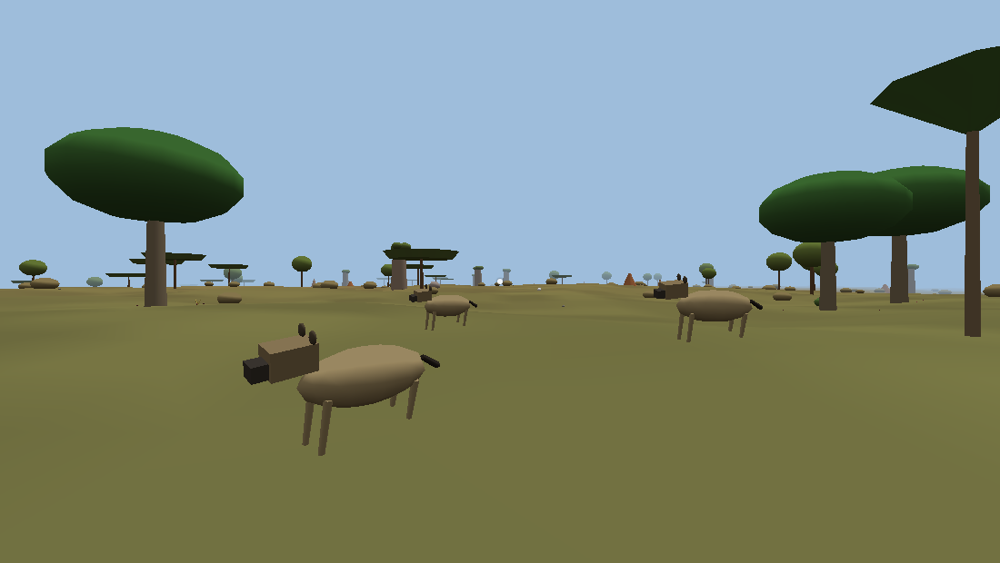
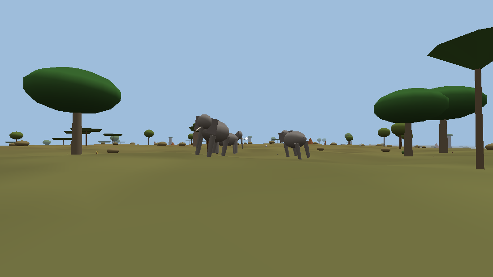

# Phase 6 — Créatures et horreur

**Statut : terminée le 13/11/2026.** Vérifiée par 202 tests unitaires (dont 21 propres à la phase 6) et 186 vérifications dans un vrai navigateur, toutes réussies, dont 18 propres à la phase 6 (ordinateur, téléphone, manette). Reste à l'essayer sur vos appareils.

## Ce que demande le cahier des charges

- **Phase 6 (section 16) :** intelligence artificielle, écosystème, créatures, détection, combats, horreur sous-marine.
- **5.1 Diversité.** Animaux terrestres, aquatiques, souterrains ; créatures hostiles, neutres, mystérieuses ; chaque espèce a ses caractéristiques.
- **5.2 Comportement.** Chasser, se défendre, défendre un territoire, coopérer avec certaines espèces, attaquer sans avertissement, détecter les joueurs, réagir aux blessures, mémoriser des habitudes, détruire des constructions. Détection selon l'espèce : vue, ouïe, traces, bruits, lumière, comportement du joueur, autres sens.
- **5.3 Évolution.** Reproduction, migrations, territoires, prédateurs et proies, populations qui évoluent, mort définitive ou réapparition selon l'espèce, apparitions fixes et dynamiques, évolution physique et comportementale.
- **5.4 Blessures.** Réaction selon l'espèce, la partie touchée, la gravité, la situation, les autres créatures et le comportement du joueur : fuir, attaquer davantage, ralentir, boiter, changer de stratégie.
- **8.1 à 8.4 Combats.** Réalistes, tactiques, physiques, improvisés ; armes de mêlée avec poids, équilibre, portée, usure ; dégâts localisés sur le joueur. Armes à feu rares, puissantes, difficiles.
- **8.8 Pièges** physiques, mécaniques et environnementaux, construits librement, pour la défense, la chasse et la protection des bases.
- **10.4** : certaines créatures détruisent les constructions. **14.5** : niveaux de simulation selon la distance et l'activité.

## Décisions (en m'inspirant de jeux du même style, sans en copier un)

> **Section 15 du cahier.** Le catalogue des créatures fait partie des éléments encore à spécifier. Le catalogue ci-dessous est une **proposition signalée et modifiable** : espèces, chiffres et comportements peuvent changer.

### Catalogue proposé : la faune du Zimbabwe, et une créature mystérieuse

| Espèce | Catégorie | Où | Groupe | Ce qu'elle fait | Sens | Mort |
| --- | --- | --- | --- | --- | --- | --- |
| Impala | terrestre, neutre (proie) | prairies, savane, vallée, miombo | harde de 4 à 10 | broute, s'alarme, fuit en bondissant ; prévient les autres | vue très large, ouïe fine | définitive ; la population se reproduit |
| Phacochère | terrestre, neutre | savane, prairie, Kalahari | 1 à 4 | fouille le sol, fuit ; charge s'il est acculé ou blessé | odorat, ouïe ; vue faible | définitive ; reproduction |
| Babouin chacma | terrestre, territorial | kopjes de granit, escarpement | troupe de 6 à 12 | aboie l'alarme (tout le monde l'entend), intimide, mord si on insiste ; **vole la nourriture** laissée au sol et revient là où il en a trouvé | vue excellente | définitive ; reproduction |
| Éléphant | terrestre, neutre mais dangereux | vallée du Zambèze, miombo, savane | harde de 3 à 7 | migre entre l'eau et la forêt ; prévient (oreilles, barrissement), fait de fausses charges puis charge ; **renverse clôtures et murs** sur son passage | odorat très fin, ouïe ; vue faible | définitive ; reproduction très lente |
| Hyène tachetée | terrestre, prédatrice | savane, vallée, prairie | clan de 3 à 5, tanière fixe | **chasse en groupe** (encercle, mord par derrière, se relaie), charognarde, **suit les vautours et les traces de sang**, teste les joueurs blessés, ronge les portes en bois quand elle sent de la viande | odorat (traces), ouïe excellente | les individus meurent ; le clan se reforme à sa tanière |
| Léopard | terrestre, prédateur solitaire | kopjes, escarpement, miombo | seul, territoire autour d'un kopje | traque à couvert, **attaque sans prévenir**, par derrière ; renonce s'il est repéré et fixé du regard ; **mémorise les endroits où il a vu le joueur** et vient s'y poster | vue, ouïe | **mort définitive** ; un autre léopard, qui ne sait rien du joueur, reprend le territoire une heure de jeu plus tard |
| Crocodile du Nil | aquatique, prédateur | fleuves, lac, zones humides | seul | guette immobile près des rives, jaillit, mord, **entraîne sous l'eau** | perçoit les remous dans l'eau | définitive ; reproduction |
| Vautour | volant, charognard | partout | 2 à 6 | tourne au-dessus des carcasses, ce qui **attire les hyènes** (et le joueur) | vue | — |
| « Ce qui dort dans le lac » | **mystérieuse**, aquatique | eaux profondes du grand lac et du Zambèze | unique | rôde dans les profondeurs, attirée par la nage, les remous et le sang ; tourne autour, passe dessous, puis saisit et entraîne vers le fond | perçoit tout mouvement dans l'eau, le sang | **ne meurt pas** : blessée, elle disparaît et revient, changée |

Pour la créature du lac, je me suis inspiré de l'atmosphère des légendes de serpents de fleuve d'Afrique australe, **sans reprendre Nyami Nyami**, divinité protectrice du peuple tonga encore respectée aujourd'hui : en faire un monstre serait irrespectueux. La créature n'a pas de nom dans le jeu ; on la découvre par indices.

**Créatures souterraines :** elles arriveront avec les grottes (phase 9), qui n'existent pas encore.

### Détection : chaque espèce a ses sens

| Sens | Comment ça marche | Ce que le joueur peut faire |
| --- | --- | --- |
| Vue | Champ de vision et portée selon l'espèce ; il faut une ligne de vue (relief, arbres, murs) | S'accroupir, rester immobile, se cacher derrière un obstacle |
| Ouïe | Chaque action fait du bruit : marcher, courir, nager, frapper, abattre un arbre, objets qui tombent | Marcher accroupi, éviter de courir et de frapper près des animaux |
| Traces et odeur | Le joueur laisse une piste qui s'efface en quelques minutes ; le sang laisse une piste plus forte et plus longue | Soigner ses plaies (bander) ; traverser l'eau |
| Lumière et feu | La plupart des animaux craignent le feu (foyer, torche, forge) | Garder un feu au camp, une torche en main |
| Remous | Crocodile et créature du lac perçoivent la nage et les éclaboussures | Nager lentement, sortir de l'eau |
| Comportement du joueur | Fuir déclenche la poursuite ; faire face et fixer un prédateur le fait hésiter ; s'accroupir près d'un félin l'encourage ; un joueur blessé ou seul attire les hyènes | Faire face, reculer lentement, rester groupés (phase 8) |

### Combats

| Décision | Inspirée de | Pourquoi |
| --- | --- | --- |
| On frappe avec ce qu'on tient (« Utiliser ») : hache, couteau, lance, bâton à fouir, pierre, ou à mains nues. Durée du coup selon la masse et l'équilibre, coût en endurance, usure | The Forest, Green Hell | Les outils de la phase 4 ont déjà masse, portée, équilibre et durabilité |
| Dégâts selon la partie touchée : tête, cou, corps, arrière-train, pattes. Une patte touchée fait boiter ; une lame ou une pointe fait saigner (piste de sang) | Hunt: Showdown, Red Dead Redemption 2 | Réactions selon la partie touchée (5.4) |
| Objets lancés (pierres, lances) : dégâts selon leur masse et leur vitesse réelles | — | Combat physique et improvisé |
| Réactions : la proie fuit ; le blessé boite et s'affaiblit ; le phacochère et le babouin contre-attaquent ; la meute se replie si deux hyènes sont blessées ; le léopard renonce ; l'éléphant blessé charge | — | « Modifier sa stratégie » |
| Attaques des créatures : blessures localisées du corps du joueur (phase 3) : morsures aux jambes, coupures graves, fractures, chocs qui projettent | — | Les soins de la phase 3 deviennent indispensables |
| Le crocodile et la créature du lac **saisissent** : on est entraîné, le souffle baisse. On se libère en frappant (la tête de préférence) ou en se débattant (E à répétition) | — | Horreur sous-marine, sans mort sans recours |
| Carcasse : on la dépèce avec une lame (viande), elle pourrit en quelques heures ; la viande crue nourrit peu, cuite au foyer elle rend beaucoup de santé | Green Hell | La chasse sert à survivre |
| **Armes à feu : reportées à la phase 9.** Elles doivent être rares et se trouver dans les bâtiments abandonnés, qui arrivent en phase 9 | — | Sans lieux où les trouver, elles seraient soit absentes, soit trop faciles à obtenir |

### Pièges (construits avec les plans de la phase 5)

| Piège | Type | Matériaux | Effet |
| --- | --- | --- | --- |
| Collet | mécanique | 2 bâtons, une corde | Retient un animal moyen (impala, phacochère, babouin, hyène), qui se débat et peut casser le collet ; **le joueur aussi peut s'y prendre** |
| Assommoir | physique | 3 bâtons, une corde, une pierre de 20 kg | La pierre, vraie pièce physique, tombe quand on touche l'appât : elle blesse selon sa masse et sa vitesse |
| Fosse à pieux | environnemental | 6 bâtons, 4 brassées d'herbes ; bâton à fouir | Couverte d'herbes, invisible ; la créature (ou le joueur) qui marche dessus tombe sur les pieux et reste prise |
| Clôture d'épines (phase 5) | défense | — | Hyènes et léopards ne la franchissent pas ; l'éléphant passe au travers |
| Feu | défense | — | Les animaux gardent leurs distances |

### Écosystème et niveaux de simulation (14.5)

| Niveau | Où | Ce qui est simulé |
| --- | --- | --- |
| Populations | tout le monde (zones de 1 km) | Nombre d'animaux par espèce : naissances, prédation, migrations vers les zones plus riches, pression de chasse du joueur |
| Individus suivis | où qu'ils soient | Léopards, clans de hyènes, troupes de babouins, créature du lac : position, santé, mémoire des habitudes, sauvegardés |
| Créatures proches | moins de 260 m du joueur | Animaux réels : sens, décisions (10 fois par seconde), déplacements, combats ; collisions seulement très près |

- **Apparitions fixes :** tanières des clans, territoires des léopards, kopjes des babouins, créature du lac.
- **Apparitions dynamiques :** les hardes et familles proviennent de la population de la zone et y retournent quand on s'éloigne.
- **Évolution du comportement :** une espèce beaucoup chassée devient méfiante ; les prédateurs qui réussissent deviennent plus hardis.
- **Évolution physique :** les jeunes grandissent ; la créature du lac grossit chaque fois qu'elle se nourrit.

### Horreur

- **Sons spatialisés** fabriqués par le navigateur, sans fichiers audio : cris des hyènes, râle du léopard, barrissements, aboiements d'alarme, souffle du crocodile, pas lourds, coups, battements de cœur. Sous l'eau, sons étouffés et grondement sourd quand la créature approche. Réglage du volume. Le son était prévu « plus tard » : je l'avance, car sans lui la détection et l'horreur ne fonctionnent pas.
- **Ce qu'on ne voit pas :** frôlements dans les herbes, hyènes qui rôdent à la limite de la vue, léopard qui n'apparaît qu'au moment d'attaquer.
- **Sous l'eau :** une silhouette immense à la limite de la visibilité, l'obscurité des profondeurs (phase 2), un grondement, puis l'attaque par en dessous.

### Reporté (avec raison)

| Élément | Phase | Raison |
| --- | --- | --- |
| Armes à feu | 9 | À trouver dans les bâtiments abandonnés |
| Créatures souterraines | 9 | Avec les grottes |
| Nuit (prédateurs nocturnes) | 9 | Le cycle jour/nuit arrive avec la météo |
| Peaux et os (vêtements, outils) | 9 ou 10 | Avec l'équipement et les vêtements |
| Attaques entre joueurs, secours | 8 | Multijoueur |

## Difficultés techniques identifiées avant de commencer

| Difficulté | Solution prévue |
| --- | --- |
| Des centaines d'animaux sur 16 km × 16 km, sur téléphone | Trois niveaux de simulation (populations, individus suivis, créatures proches) ; au plus 24 créatures réelles sur téléphone, 40 sur ordinateur |
| Faire marcher des animaux sur un relief, autour des arbres et des murs, sans moteur de navigation | Déplacement sur la hauteur exacte du terrain ; évitement par rayons vers l'avant (arbres, rochers, murs) dans la zone physique ; pente et profondeur d'eau limites par espèce |
| Collisions joueur-animal, objets lancés | Collisionneur cinématique par créature proche ; trajectoire des objets lancés testée à chaque pas contre le corps des créatures (vitesse réelle avant le choc) |
| Localiser un coup | Corps de chaque espèce décrit par une capsule ; le point touché, dans le repère de l'animal, donne la partie (tête, corps, pattes) |
| Déterminisme (le serveur fera foi en phase 8) | Générateur pseudo-aléatoire rangé dans l'état, aucune dépendance au temps réel ni à l'affichage |
| Animer des animaux sans modèles 3D | Animaux faits de formes simples, pattes animées selon la vitesse (instances, peu d'appels de dessin) |
| Sons sans fichiers, sur téléphone | Synthèse Web Audio (oscillateurs, bruit filtré), spatialisation ; démarrage au premier appui (règle des navigateurs) ; nombre de voix limité |
| Ne pas rendre le jeu inutilement punitif (13.6) | Signes avant-coureurs (cris, alarmes des babouins, grondement sous l'eau), fuite possible (eau, kopjes, feu), possibilité de se libérer d'une prise |

## Ce qui a été fait

### Les créatures (chiffres de la proposition, modifiables)

| Espèce | Santé | Vitesse (marche / course, m/s) | Vue (m, champ) | Odorat (m) | Attaque |
| --- | --- | --- | --- | --- | --- |
| Impala | 60 | 1,3 / 12 | 75, 300° | 40 | — (fuit) |
| Phacochère | 80 | 1,0 / 8,5 | 25, 220° | 40 | défenses : coupure aux jambes, 12 |
| Babouin | 50 | 1,4 / 9 | 90, 180° | 15 | morsure aux bras et aux jambes, 9 |
| Éléphant | 900 | 1,5 / 6,5 | 30, 200° | 120 | charge : 55, fracture probable, projette à 9 m/s |
| Hyène | 90 | 1,6 / 11 | 60, 200° | 150 (pistes) | morsure aux jambes, 14, coupure grave 35 % |
| Léopard | 110 | 1,5 / 16 | 90, 200° | 30 | 26 (× 1,4 par derrière), coupure grave 50 % |
| Crocodile | 300 | 0,8 sur terre, 2,5 dans l'eau, bond à 9 | 25, 170° | remous | morsure et prise : 20 puis 4 par seconde |
| Créature du lac | 600 (puis se retire) | 3, attaque à 9 | 20 ; mouvements dans l'eau, sang | — | saisie : 8, puis 2 par seconde, souffle trois fois plus court |

Les jeunes sont plus petits et plus faibles, puis grandissent. Chaque espèce a ses biomes, sa densité, la taille de ses groupes et son rythme de reproduction (`src/shared/creatures.ts`).

### Sens et détection

- **Vue :** portée et champ propres à l'espèce, multipliés par la visibilité du joueur :
  - accroupi : × 0,45, ou × 0,32 s'il avance lentement ;
  - immobile : × 0,7 ; en train de courir : × 1,3 ;
  - à la nage : × 0,7 ; sous l'eau, invisible pour les animaux terrestres ;
  - un animal qui broute, tête baissée, voit moins bien.
  Il faut une ligne de vue : rayon contre le relief, les rochers, les troncs et les murs dans la zone physique, relief seul plus loin.
- **Ouïe :** chaque bruit a une portée :

  | Bruit | Portée |
  | --- | --- |
  | Marche | 10 m |
  | Marche accroupie | 3 m |
  | Course | 28 m |
  | Nage | 14 m (30 m en nage rapide) |
  | Coup d'outil | 12 à 30 m |
  | Coup d'arbre à la hache | 40 m |
  | Arbre qui tombe | 120 m |
  | Combat | 20 m |

  L'ouïe de chaque espèce multiplie ces portées.
- **Pistes :** le joueur laisse une piste tous les 3 m, qui s'efface en 10 minutes. S'il saigne, elle est plus forte et dure 20 minutes. Les hyènes la suivent.
- **Feu :** chaque espèce a une distance de crainte. Les hyènes ne s'approchent pas d'un joueur qui tient une torche ou qui se tient près d'un feu.
- **Vigilance :** de 0 à 1, elle monte avec ce que l'animal perçoit et redescend lentement. L'animal réagit au-delà d'un seuil.
- **Regard :** un léopard que le joueur fixe du regard (à moins de 30 m, pendant 1,5 s) renonce et se replie pour deux minutes.

### Comportements

- **Impalas :**
  - s'alarment (tête haute, face au danger), puis fuient en bondissant et poussent un cri d'alarme ;
  - les autres herbivores qui l'entendent fuient aussi ;
  - un joueur qui court les fait fuir de plus loin (× 1,4), un joueur accroupi de moins loin (× 0,6).
- **Phacochère :** fuit. Acculé ou blessé, il charge puis repart.
- **Babouins :**
  - aboient l'alarme (les impalas proches fuient) ;
  - les mâles font de fausses charges jusqu'à 5 m, puis mordent si l'on insiste à moins de 4,5 m ou si l'on en frappe un ;
  - ils volent la nourriture laissée au sol ou dans un sac posé (à plus de 14 m du joueur) et retiennent l'endroit, où ils reviennent.
- **Éléphants :**
  - suivent un itinéraire entre l'eau et la forêt, en broutant ;
  - en alerte : grondement ; trop près (22 m, 30 m s'il y a des petits) : fausse charge et barrissement ; à moins de 12 m ou si l'un est blessé : vraie charge ;
  - ils renversent les clôtures et les murs qui leur barrent la route (la pierre résiste mieux).
- **Hyènes :**
  - tanière fixe et territoire ; elles évaluent la vulnérabilité du joueur (santé, saignement, jambe blessée, viande, arme, feu, nombre) ;
  - joueur bien portant : elles le suivent à distance, à la limite de la vue, en riant ;
  - joueur affaibli : elles l'encerclent, puis mordent l'une après l'autre, par derrière ;
  - elles se replient si deux d'entre elles sont blessées ;
  - elles mangent les carcasses, viennent quand les vautours tournent, chassent les impalas, rongent les portes en bois derrière lesquelles il y a de la viande.
- **Léopard :**
  - territoire autour d'un kopje ; patrouille vers les endroits où il a vu le joueur (mémoire de six lieux) ;
  - traque en tournant autour du joueur pour passer dans son dos, s'immobilise quand on regarde vers lui ;
  - bondit à moins de 9 m, plus loin si le joueur est accroupi.
- **Crocodile :**
  - guette à fleur d'eau près des rives ; perçoit qui nage ou marche dans l'eau à 40 m ;
  - approche, jaillit, mord ; dans l'eau, saisit et entraîne vers le fond en roulant (8 s au plus).
- **Créature du lac :**
  - son attention monte quand le joueur nage dans les eaux profondes ; elle monte plus vite s'il nage vite, plonge ou saigne ;
  - elle remonte des profondeurs hors de la vue, tourne autour de plus en plus près, passe dessous, puis attaque par en dessous, saisit et tire vers le fond (7 s au plus) ;
  - elle ne quitte pas les eaux profondes : on lui échappe en regagnant le bord ;
  - blessée, elle se retire et disparaît pendant 15 minutes de jeu, plus méfiante (elle tourne plus longtemps avant d'attaquer) ;
  - quand elle tue, elle grandit et s'enhardit.
- **Vautours :** une minute après une mort, ils tournent au-dessus de la carcasse (visibles de loin), puis se posent et mangent. Ils s'envolent si l'on approche, et attirent les clans de hyènes à moins de 1,8 km.

### Écosystème (niveaux de simulation)

- **Populations :** zones de 1 km (256 sur le monde), avec une capacité par espèce selon les biomes. Chaque minute de jeu :
  - naissances (croissance logistique, freinée par la peur) et prédation par les hyènes ;
  - migrations vers la zone voisine moins peuplée (éléphants : 10 % par heure) ;
  - la pression de chasse retombe peu à peu.
- **Individus suivis :** léopards, clans de hyènes et troupes de babouins, à des sites déterministes (cases de 2 km), ainsi que la créature du lac.
  - Loin du joueur, ils se déplacent dans leur territoire et leurs effectifs se reforment.
  - Ils apparaissent à moins de 240 m et repassent à l'état abstrait au-delà de 300 m.
- **Créatures proches :** les hardes et familles viennent de la population de la zone (à 150-200 m) et y retournent au-delà de 280 m.
  - Au plus 40 créatures réelles sur ordinateur, 24 sur téléphone.
  - Elles décident 10 fois par seconde quand il se passe quelque chose, 4 fois sinon, moins encore au loin.
- **Évolution :**
  - tuer une espèce rend la zone et l'espèce plus méfiantes (fuite de plus loin, moins d'apparitions) ;
  - un prédateur qui réussit s'enhardit, un prédateur repoussé perd courage ;
  - tout revient lentement à la normale.

### Combats

- **Coup :** « Utiliser » (clic droit ou F, LT, « Utiliser ») sur l'animal visé, à portée du bras plus celle de l'outil (lance : 2,9 m).
  - Délai entre deux coups : 0,35 à 1,3 s selon la masse et l'équilibre ; endurance : 3 + 2,5 × masse.
  - Dégâts = (6 + 9 × puissance de l'outil, qui dépend de sa qualité et de son état) × √(masse + 0,3) × tranchant (lame × 1,3, hache × 1,4, pointe × 1,6), réduits de moitié avec un bras cassé non soigné. À mains nues : 3.
  - Multiplicateur selon la partie touchée : tête × 2, cou × 1,6, flanc × 1, arrière-train × 0,8, pattes × 0,6 (font boiter).
  - Une lame ou une pointe fait saigner (piste de sang, l'animal s'affaiblit).
  - Le coup use l'outil et fait chanceler l'animal, ce qui interrompt son attaque.
- **Objets lancés :** dégâts selon l'énergie réelle (½ × masse × vitesse²) : × 0,22 pour une pierre, × 0,6 pour une lance (qui fait saigner).
- **Attaques sur le joueur :**
  - zone tirée selon l'espèce (jambes pour les animaux bas, torse et tête pour le léopard) ; coupure (grave ou non), fracture, commotion ;
  - choc qui projette, geste interrompu, objet lâché ;
  - à terre, un prédateur achève sa proie (35 % par morsure : mort « l'attaque d'un animal »).
- **Prises :** tenu, le joueur ne bouge plus.
  - On se libère en frappant (la tête de préférence : 70 %) ou en se débattant (E ou saut à répétition).
  - Le crocodile lâche au bout de 8 s, la créature du lac au bout de 7 s.

### Carcasses et viande

- **Carcasse :** elle garde la viande de l'espèce (impala : 6 morceaux, éléphant : 20). Elle est avariée au bout d'une heure de jeu et disparaît au bout de trois heures, ou dix minutes après qu'on l'a vidée.
- **Dépeçage :** une lame en main, « Utiliser » prélève 2 morceaux par geste (5 à 16 s).
- **Viande crue :** 6 de santé sur 30 s. **Viande cuite :** 30 de santé sur 60 s.
- **Cuisson :** sur un foyer allumé, 4 morceaux à la fois, en 45 s (« Poser sur le feu », puis « Reprendre la viande »).

### Pièges et défense des bases

- **Collet :**
  - retient un animal de 130 kg au plus, qui se débat et peut le casser ; il faut alors une corde pour le réarmer ;
  - un animal plus lourd l'arrache ;
  - le joueur qui y marche est pris (entorse possible) : E pour se dégager.
- **Assommoir :** une vraie pierre de 20 kg tombe sur ce qui touche le déclencheur, joueur compris. Les dégâts suivent sa masse et sa vitesse. Il faut 15 kg de pierres posées à côté pour le réarmer.
- **Fosse à pieux :**
  - 75 de dégâts aux pattes, l'animal reste pris (l'éléphant n'est que blessé) ;
  - le joueur tombe : 20 à 35 de dégâts, entorse ou fracture, coupures ; E pour en sortir ;
  - 2 brassées d'herbes pour la recouvrir.
- **Clôtures, murs, portes :** les animaux (sauf l'éléphant) ne passent pas. Les hyènes rongent les portes en bois quand elles sentent de la viande.

### Sons et horreur

- **Synthèse dans le navigateur, sans fichiers :** cris des hyènes (glissando « whoop », rire), râle « en scie » du léopard, barrissement et grondement des éléphants, aboiement des babouins, alarme des impalas, souffle du crocodile, grondement très grave de la créature du lac, morsures, coups, pas lourds, frôlements, vautours, collet qui claque.
- **Spatialisation :** sons placés dans l'espace (HRTF sur ordinateur, simple panoramique sur téléphone), volume selon la distance. Au plus 14 voix.
- **Cœur :** il bat plus vite quand un prédateur rôde, encercle ou charge à moins de 35 m.
- **Sous l'eau :** sons étouffés, souffle sourd, bourdonnement battant (31 et 33,5 Hz) quand la créature est proche ; les bords de la vue s'assombrissent.
- **Ce qu'on ne voit pas :** frôlements des animaux proches, hyènes à la limite de la vue, silhouette sombre et deux reflets pâles dans l'eau.

### Affichage

- Animaux en formes simples, instanciés par partie : peu d'appels de dessin.
- Pattes animées selon la vitesse, tête basse pour brouter, haute en alerte ; élan pendant la préparation d'une attaque ; animal couché au repos ; animal pris qui se débat.
- Trompe et oreilles de l'éléphant ; ailes des vautours ; corps du crocodile et queue qui ondule.
- Carcasses couchées sur le flanc ; traces de sang au sol (les 120 plus proches).
- Distance d'affichage des créatures : 90 m en Basse, 130 m en Moyenne, 180 m au-delà.

### Interface et commandes

| Action | Ordinateur | Manette | Téléphone |
| --- | --- | --- | --- |
| Frapper l'animal visé | clic droit ou F | LT | « Utiliser » |
| Lancer une pierre, une lance | clic gauche | RT | « Lancer » |
| Se débattre (tenu par une créature) | E (ou Espace) | X (ou A) | « Prendre » |
| Se dégager d'un piège, réarmer un piège | E | X | « Prendre » |
| Dépecer une carcasse (lame en main) | clic droit ou F | LT | « Utiliser » |

Les indications à l'écran nomment l'animal visé (« F : frapper le phacochère »), la carcasse (« dépecer la carcasse, 5 morceaux ») et l'état d'un piège. Le volume se règle dans les réglages, section Son.

### Outils de test (temporaires)

Réglages, section Outils de test :
- **Créatures :** faire apparaître des impalas, des phacochères, des babouins, des éléphants, des hyènes, un léopard ou un crocodile à 25 m devant vous.
- **Lac :** nager au-dessus des eaux profondes, là où rôde la créature.

## Tests

### Tests unitaires (Vitest) : `tests/unit/phase6-fauna.test.ts`, 21 tests

- **Catalogue et géométrie :** chaque espèce a des valeurs cohérentes ; noms et articles ; un rayon touche la capsule du corps ; la partie touchée dépend du point d'impact.
- **Sens et comportements :**
  - les impalas fuient le joueur qui court et donnent l'alarme ; accroupi et lent, on s'approche bien plus près ;
  - les hyènes mordent un joueur blessé et seul, mais gardent leurs distances près d'un feu ;
  - le léopard attaque par derrière, et se replie s'il est fixé du regard ;
  - les éléphants préviennent puis chargent.
- **Combats :**
  - coup de lance localisé, carcasse, dépeçage, cuisson, viande cuite ; pierre lancée qui blesse ;
  - le crocodile saisit et lâche quand on le frappe à la tête, ou quand on se débat ;
  - un prédateur achève le joueur à terre.
- **Pièges :** collet sur un impala ; joueur pris puis libéré ; fosse ; pierre de l'assommoir qui tombe.
- **Écosystème :**
  - populations qui croissent ; pression de chasse ; mémoire des lieux du léopard ;
  - sauvegarde et relecture (y compris une ancienne sauvegarde sans faune) ; déterminisme ;
  - le babouin vole la nourriture et s'en souvient.
- **Créature du lac (monde réel) :** elle vient quand on nage, tourne, saisit et entraîne ; frappée, elle lâche et disparaît sans mourir ; elle devient plus méfiante.

### Dans un vrai navigateur (Playwright, scénario `phase6`), 18 vérifications

- **Ordinateur :**
  - des animaux apparaissent selon la région ; le premier clic démarre le son ;
  - les impalas fuient ; la lance blesse (« F : frapper le phacochère »), carcasse, dépeçage, cuisson ;
  - les hyènes mordent le joueur blessé (bord rouge) ;
  - pièges dans l'onglet Construire ; le collet retient un impala ;
  - la créature du lac saisit le nageur, qui se dégage en se débattant (la vue s'assombrit) ;
  - sauvegarde ; réglages (volume, apparitions) ; aucune erreur.
- **Téléphone :** « Utiliser » frappe l'animal visé.
- **Manette :** LT frappe.

Les scénarios des phases 1 à 5 se jouent désormais sans créatures (réglage réservé aux tests) : un animal ne doit pas fausser un test qui n'a rien à voir.

## Limites et compromis (signalés)

- **Formes simples, animation procédurale :** pas de vrais modèles 3D ni de squelettes animés pour l'instant (graphismes soignés plus tard).
- **Déplacements sans calcul d'itinéraire :** évitement par rayons vers l'avant. Un animal peut se coincer contre un obstacle complexe ; il essaie alors une autre direction.
- **Pas de collision physique entre les créatures et les objets :** un objet lancé qui touche un animal rebondit par un calcul simple. Le joueur est repoussé par les corps des animaux.
- **Combats sans animation de coup :** l'outil ne bouge pas ; un éclair rouge et une secousse signalent les morsures.
- **Créatures lointaines simplifiées :** au-delà de 160 m, elles décident moins souvent ; dans la zone physique, elles évitent les arbres ; plus loin, seulement le relief et l'eau.
- **Compromis mobiles :** 24 créatures au plus sur téléphone (40 sur ordinateur) ; sons spatialisés plus simples (sans HRTF) ; créatures affichées à 90 m en qualité Basse.
- **Sans nuit (phase 9),** pas encore de chasses nocturnes.
- **La méfiance des espèces et la croissance de la créature du lac** sont des choix de jeu signalés et modifiables (section 15).

## Inspirations (pas de sources consultées pour cette phase)

- Les comportements et les chiffres viennent de connaissances générales sur ces espèces : la hyène chasse en clan et suit les vautours ; le léopard attaque par surprise et renonce quand il se sait repéré ; on conseille de faire face à un félin, de ne pas courir ni s'accroupir. Je n'ai pas consulté de documentation précise pendant cette phase : ce sont des propositions à corriger si vous le souhaitez.
- Jeux du même style, pour la perception et la tension :
  - The Forest et Sons of the Forest : des créatures qui observent avant d'attaquer ;
  - Hunt: Showdown : des bruits qui trahissent ;
  - Subnautica : l'horreur des profondeurs ;
  - Green Hell : chasse et cuisson.
